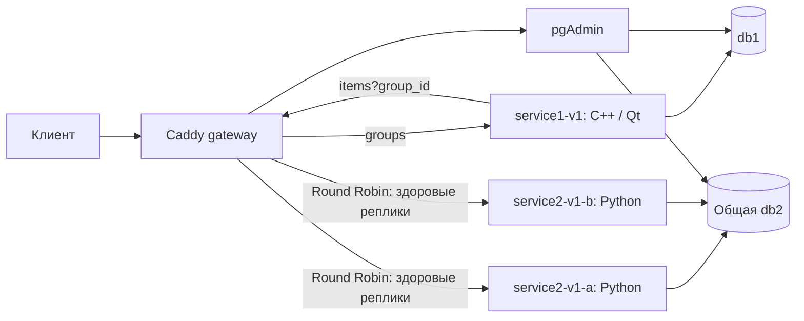

# msa2026-docker

Учебный проект с семью контейнерами: Service1 на **C++17 / Qt / CMake**, две реплики Service2 на **Python / FastAPI**, две PostgreSQL, pgAdmin и Caddy. Обе реплики Service2 работают с **одной db2**. Внешний адрес стенда — `http://localhost:8080`.



Требования: [TASK.md](TASK.md). Сервисы реализуют чтение API v1. Service1 владеет groups, логический Service2 — items. Исходники независимы: `service1/src/` и `service2/app/main.py`; общего C++-кода нет. В Service1 `main.cpp` содержит запуск и обработку завершения, а `Application`, `Client`, `Config`, `Database`, `Reply` вынесены в собственные `.h`/`.cpp`; проверки идентификаторов — в `Validation.h/.cpp`.

## Запуск

Нужны Docker Engine/Desktop с Linux-контейнерами и Compose v2 с поддержкой `--wait` (рекомендуется 2.20+). Сборке нужен интернет. C++/Qt/CMake/Python для приложений устанавливаются внутри образов. Для отдельного `smoke.py` достаточно Python 3.6+, для полного набора тестов используйте Python 3.10+; CI проверяет Python 3.12. На Linux запускайте тесты явно через `python3`: команда `python` на старых Ubuntu может означать Python 2.7.

```sh
git clone https://github.com/sidorin001/msa2026-docker.git
cd msa2026-docker
cp .env.example .env
```

В PowerShell: `Copy-Item .env.example .env`. Замените пять паролей `CHANGE_ME_…` разными значениями. Если используются специальные символы, учитывайте правила Compose dotenv. `.env` не коммитится.

```sh
docker compose config --quiet
docker compose up --build -d --wait --wait-timeout 180
docker compose ps
python3 tests/smoke.py --base-url http://localhost:8080
```

В Ubuntu 18.04 системный Python 3 относится к ветке 3.6. Для запуска smoke-теста установите его рядом с Python 2, не заменяя системный `/usr/bin/python`:

```sh
sudo apt update
sudo apt install python3
python3 --version
python3 tests/smoke.py --base-url http://localhost:8080
```

В shell от root команды `sudo` не нужны. Если хотите использовать краткое имя в текущем интерактивном Bash: `alias python=python3`. Это не меняет системный интерпретатор. В Windows, где установлен Python 3, можно использовать `py -3 tests/smoke.py --base-url http://localhost:8080`.

Для smoke-теста без установки Python на Linux-хост доступен контейнерный вариант (стенд должен быть запущен):

```sh
docker run --rm --network host -v "$PWD:/workspace:ro" -w /workspace python:3.12.8-slim-bookworm python3 tests/smoke.py --base-url http://localhost:8080
```

`--network host` здесь рассчитан на Docker Engine в Linux. Версия Python внутри Service2 уже задана его образом и не зависит от Python на хосте. Справка Ubuntu: [версии Python по выпускам](https://ubuntu.com/developers/docs/reference/availability/python/), [работа с системным Python](https://documentation.ubuntu.com/ubuntu-for-developers/howto/python-setup/).

Образ `msa2026-service2:local` собирается один раз через `service2-v1-a`, затем используется обеими репликами. Запускайте весь Compose-проект; отдельный запуск B на чистом компьютере требует сначала сборки A. Именованные контейнеры через `container_name` не задаются; другой проект можно запустить с `docker compose -p <name>` и другим внешним портом. pgAdmin может готовиться дольше API — дождитесь формы входа.

## API

| Метод и путь | Обработчик |
|---|---|
| `GET /api/v1/groups` | Service1: список групп |
| `GET /api/v1/groups/{id}` | Service1: одна группа |
| `GET /api/v1/groups/{id}/items` | Service1 → Caddy → здоровая реплика Service2 |
| `GET /api/v1/items` | Caddy → Service2: все элементы |
| `GET /api/v1/items/{id}` | Caddy → Service2: один элемент |
| `GET /api/v1/items?group_id={id}` | Caddy → Service2: фильтр по группе |

```sh
curl http://localhost:8080/api/v1/groups
curl http://localhost:8080/api/v1/groups/2
curl -i http://localhost:8080/api/v1/groups/2/items
curl -i http://localhost:8080/api/v1/items
curl http://localhost:8080/api/v1/items/3
curl 'http://localhost:8080/api/v1/items?group_id=2'
```

В PowerShell используйте `curl.exe`. Заголовок `X-Service2-Instance` показывает обработавшую запрос реплику; Service1 сохраняет его при агрегировании. JSON от этого не меняется: группа `{"id":1,"name":"Group 1"}`, элемент `{"id":1,"group_id":1,"name":"Item 1"}`, списки — массивы, сортировка по ID.

Seed: 4 группы, 10 элементов; у групп 1–4 соответственно **2 / 3 / 5 / 0** элементов. Service1 проверяет существование группы до вызова Service2. Нет группы — `404`; группа без элементов — `200 []`; прямой фильтр Items по неизвестному положительному group_id — `200 []`.

Положительные 32-битные ID валидируются до SQL. Ошибки: `400` (включая стандартные случаи валидации FastAPI, вместо его 422), `404`, `405` с `Allow: GET, HEAD`; HEAD поддерживается, OPTIONS известного ресурса возвращает 405. Неизвестные query-параметры игнорируются; повторный `group_id` отклоняется. Старые `/context/`, неверсионированные пути, v2 и `groups-extra` не обслуживаются. Ошибки приложения: `{"error":{"code":"not_found","message":"Group not found"}}`.

Собственная БД недоступна — `503`; ошибка зависимости при агрегировании — `502`, собственный timeout Service1 — `504`. Caddy при отсутствии здоровых upstream возвращает собственный `502/503`, неизвестные внешние маршруты — текстовый `404`. Сбой зависимости не заменяется пустым массивом.

## Round Robin и здоровье реплик

Caddy содержит два явных upstream: `service2-v1-a:8080`, `service2-v1-b:8080`, политику `round_robin` и независимые активные HTTP-проверки. Балансировка происходит на каждый HTTP-запрос, в том числе при keep-alive; DNS не используется как замена балансировщику. Внешний и внутренний Items-трафик использует один обработчик Caddy и общий счётчик Round Robin, поэтому во время проверки строгого чередования не должно быть других API-запросов.

| Настройка | Значение |
|---|---|
| readiness каждой реплики | `GET /ready`, строго HTTP 200 |
| `health_interval` | 5 секунд |
| `health_timeout` | 2 секунды |
| `health_fails` | 1 неуспешная проверка исключает реплику |
| `health_passes` | 2 последовательные успешные проверки возвращают реплику |
| timeout Caddy → Service2 | connect 2s, response headers 5s |
| timeout Service1 → балансировщик | connect 2s, общий deadline 10s |
| timeout Caddy → Service1 | response headers 20s |

`/ready` выполняет запрос к db2, `/health` проверяет процесс. Оба пути доступны только внутри окружения. При одной здоровой реплике весь Items-трафик идёт ей; после успешных проверок восстановленная реплика автоматически включается без reload Caddy. Docker healthcheck полезен для запуска и диагностики, но исключение из балансировки обеспечивает именно Caddy.

Passive `fail_duration` и повторы запросов не включены: истечение таймера не возвращает неисправный экземпляр без успешной активной проверки. Между фактическим отказом и его обнаружением возможны ошибки отдельных запросов; уже начавшийся запрос не переносится автоматически. Проверки CI ожидают исключение/возврат с deadline 30 секунд. Если нездоровы обе реплики, Items API выдаёт ошибку, а Groups API продолжает работать. Общая db2 — единая зависимость двух реплик; её репликация в проект не входит.

Демонстрация (выждите обнаружение по healthcheck):

```sh
docker compose stop service2-v1-a
curl -i http://localhost:8080/api/v1/items
curl -i http://localhost:8080/api/v1/groups/2/items
docker compose start service2-v1-a
docker compose logs --tail 50 gateway
```

После двух успешных проверок A снова получает запросы. Аналогично можно проверить B. При `pause` процесс перестаёт отвечать, и Caddy исключает его по timeout; после проверки выполните `docker compose unpause service2-v1-a`.

## Технологии и Dockerfile

Формат C++ Service1 задаётся корневым `.clang-format` (clang-format 18.1.8): отступ 4 пробела, строки до 100 символов, пустая строка между определениями классов и функций, короткие функции раскрыты на несколько строк. В CI выполняется проверка соответствия. Для применения из корня репозитория:

```sh
clang-format-18 -i service1/src/*.h service1/src/*.cpp
clang-format-18 --dry-run --Werror service1/src/*.h service1/src/*.cpp
```

При установке через `python3 -m pip install clang-format==18.1.8` команда называется `clang-format` без суффикса `-18`.

Service1: Qt 6.4.2 из Debian bookworm, C++17, CMake ≥3.22; Qt HTTP Server обрабатывает HTTP, Qt JSON — ответы, Qt Network — асинхронный вызов балансировщика, Qt SQL/QPSQL — параметризованные запросы. Qt Concurrent выполняет блокирующие SQL-запросы в пуле из 8 потоков; каждое соединение создаётся, используется и удаляется в одном worker-потоке. Главный event loop продолжает принимать запросы. GUI и display server не требуются. Ответы ограничены 1 MiB, тайм-аут сетевого вызова конечный. SIGTERM/SIGINT обрабатываются через `sigwait` и очередь Qt.

Service2: Python 3.12.8, FastAPI 0.115.6, Uvicorn 0.34.0, Psycopg 3.2.3. Все транзитивные зависимости закреплены в `service2/requirements.txt`. Синхронный обработчик выполняет DB-запросы в worker pool Starlette, не блокируя async event loop. Соединение с БД создаётся на запрос; потеря соединения не требует рестарта приложения. SQL передаётся драйверу с отдельными параметрами.

Оба Dockerfile — multi-stage. Service1 собирается в build-stage на Debian `bookworm-20250908-slim`; runtime содержит Qt shared libraries, QPSQL-плагин, бинарник и curl. Service2 собирает wheels/virtualenv на `python:3.12.8-slim-bookworm`, runtime содержит интерпретатор, virtualenv, Python-код и curl. Компиляторов и CMake в runtime нет. Обе программы работают под UID 10001, Compose использует `init: true`. Логи — stdout/stderr без паролей и тел запросов.

PostgreSQL `17.6-bookworm`, Caddy `2.10.2-alpine`, pgAdmin `9.8`. Это закреплённый учебный набор, а не обозначение самых новых версий. Системные пакеты получают доступные обновления Debian; побитная воспроизводимость apt не заявляется. Лицензии: [THIRD_PARTY.md](THIRD_PARTY.md), исходники проекта — [GPL-3.0-only](LICENSE), учитывая лицензию Qt HTTP Server.

## БД, сети и данные

db1: `groups(id INTEGER PRIMARY KEY, name TEXT NOT NULL)`. Общая db2: `items(id INTEGER PRIMARY KEY, group_id INTEGER NOT NULL, name TEXT NOT NULL)`, индекс group_id. group_id — логическая ссылка: SQL FOREIGN KEY между независимыми экземплярами PostgreSQL не создаётся. Согласованность seed детерминирована; записи API не поддерживает.

App-роли имеют CONNECT только к своей БД, USAGE public и SELECT таблиц; не имеют SUPERUSER, TEMP, DDL, INSERT/UPDATE/DELETE и CONNECT к postgres/template1. PgAdmin подключается отдельным административным пользователем postgres. Пароли в init-скриптах передаются через `psql \getenv` с SQL-экранированием.

Сети: `api` — Caddy, Service1 и обе реплики Service2; `admin` — Caddy/pgAdmin; `db1-net` (internal) — db1/Service1/pgAdmin; `db2-net` (internal) — db2/обе реплики Service2/pgAdmin. Gateway не имеет сети БД. На хост публикуется только gateway; прямых портов БД/реплик/pgAdmin нет.

Именованные volumes сохраняют db1, db2, pgAdmin и данные Caddy. SQL-init исполняется только на пустой БД: запуск второй реплики не выполняет seed заново. Изменение паролей в `.env` не меняет уже созданные роли/pgAdmin — измените их средствами БД/приложения или пересоздайте одноразовый стенд.

## Настройки и pgAdmin

Все параметры: `.env.example`. Порт gateway — `GATEWAY_BIND=127.0.0.1`, `GATEWAY_PORT=8080`. DB1/DB2 имеют отдельные имена, app-пользователей и app/admin-пароли. Внутренние порты: API 8080, PostgreSQL 5432. Compose отображает значения в `DB_HOST`, `DB_PORT`, `DB_NAME`, `DB_USER`, `DB_PASSWORD`, `HTTP_PORT`.

`SERVICE2_BASE_URL=http://gateway:80`; `INSTANCE_ID` задаётся отдельно для A/B в Compose. `HTTP_CONNECT_TIMEOUT_MS=2000`, `HTTP_READ_TIMEOUT_MS=10000`; `DB_CONNECT_TIMEOUT_SECONDS=2`, `DB_STATEMENT_TIMEOUT_MS=3000`. Изменяя тайм-ауты, согласуйте их с Caddy и healthcheck. Для открытия стенда в локальной сети можно осознанно изменить bind; интернет-публикация требует отдельной защиты и TLS.

Откройте `http://localhost:8080/pgadmin/`, войдите с `PGADMIN_DEFAULT_EMAIL` / `PGADMIN_DEFAULT_PASSWORD`. В группе MSA есть DB1 — Groups (`db1`) и DB2 — Items (`db2`): обе реплики используют именно DB2, третьего сервера БД нет. При подключении введите соответствующий DB1/DB2_ADMIN_PASSWORD. `servers.json` не содержит паролей. При нестандартных DB1_NAME/DB2_NAME нужная БД отображается в Databases; maintenance DB остаётся postgres.

Caddy снимает `/pgadmin` перед upstream и передаёт `X-Script-Name: /pgadmin`, сохраняя внешние ссылки/redirects. API-префикс сохраняется. PgAdmin работает в server mode; master password не требуется, enhanced cookie protection отключена для локального прокси. Браузерный CI использует стандартную локаль `en-US`, поскольку POSIX locale runner несовместима с Intl pgAdmin 9.8.

## Обслуживание и проверки

```sh
docker compose logs -f service1-v1 service2-v1-a service2-v1-b gateway
docker compose build service1-v1 service2-v1-a
docker compose up -d --wait --wait-timeout 180
docker compose exec service1-v1 curl -fsS http://localhost:8080/ready
docker compose exec service2-v1-a curl -fsS http://localhost:8080/ready
docker compose down
```

`down` сохраняет данные. **Следующая команда удаляет все данные БД и pgAdmin этого проекта; только для полного сброса одноразового стенда:**

```sh
docker compose down --volumes --remove-orphans
docker compose up --build -d --wait --wait-timeout 180
```

Если порт занят, измените GATEWAY_PORT. Если API не готов — `docker compose ps`, логи БД/реплик и Caddy, проверка первоначальных паролей и доступности QPSQL. Не публикуйте `.env` и полный `docker compose config`. Для Caddy: `docker compose run --rm --no-deps gateway caddy validate --config /etc/caddy/Caddyfile --adapter caddyfile`.

Тесты и ограничения их запуска: [tests/README.md](tests/README.md). Результаты: [VALIDATION.md](VALIDATION.md), [GitHub Actions](https://github.com/sidorin001/msa2026-docker/actions). Проверки отказов и тестовые override-файлы предназначены только для отдельного одноразового окружения.
