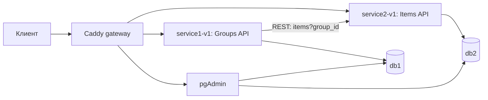

# msa2026-docker

Учебный проект: два REST-сервиса на C++17/CMake, две PostgreSQL, pgAdmin и Caddy. Единственная опубликованная точка входа — `http://localhost:8080`.



Требования и критерии: [TASK.md](TASK.md). Реализованы только чтение и API v1. Исходники расположены в `service1/`, `service2/`; общий код подключения, JSON и HTTP — в `common/`. Каждый каталог сервиса — отдельный CMake-проект с собственным бинарником и Dockerfile; для сборки нужен также соседний `common/`.

## Быстрый запуск

Нужны Docker Engine/Desktop с Linux-контейнерами и Docker Compose v2 с `--wait` (рекомендуется 2.20+). Для smoke-тестов нужен Python 3.10+. Локальные C++ и CMake не нужны. Сборке нужен интернет для образов, Debian-пакетов и закреплённых C++-зависимостей.

```sh
git clone https://github.com/sidorin001/msa2026-docker.git
cd msa2026-docker
cp .env.example .env
```

В PowerShell вместо `cp`: `Copy-Item .env.example .env`. Замените пять значений `CHANGE_ME_…` в `.env` разными паролями. Для первого запуска удобно использовать длинные буквенно-цифровые пароли; специальные символы должны быть корректно экранированы по правилам Compose dotenv. Не публикуйте `.env`.

```sh
docker compose config --quiet
docker compose up --build -d --wait --wait-timeout 180
docker compose ps
python tests/smoke.py --base-url http://localhost:8080
```

Первый запуск собирает два образа и создаёт данные. pgAdmin может запускаться дольше API; дождитесь формы входа на `http://localhost:8080/pgadmin/`.

## API

| Запрос | Назначение |
|---|---|
| `GET /api/v1/groups` | Все группы |
| `GET /api/v1/groups/{id}` | Группа |
| `GET /api/v1/groups/{id}/items` | Элементы группы через Service1 → Service2 |
| `GET /api/v1/items` | Все элементы |
| `GET /api/v1/items/{id}` | Элемент |
| `GET /api/v1/items?group_id={id}` | Элементы группы непосредственно через Service2 |

```sh
curl http://localhost:8080/api/v1/groups
curl http://localhost:8080/api/v1/groups/2
curl http://localhost:8080/api/v1/groups/2/items
curl http://localhost:8080/api/v1/items
curl http://localhost:8080/api/v1/items/3
curl 'http://localhost:8080/api/v1/items?group_id=2'
```

В Windows PowerShell используйте `curl.exe` вместо `curl`.

Ответы — JSON, списки — массивы с сортировкой по ID. Примеры: `{"id":1,"name":"Group 1"}`, `{"id":1,"group_id":1,"name":"Item 1"}`. Групп четыре, элементов десять; у групп 1–4 соответственно **2, 3, 5, 0** элементов.

Service1 сначала проверяет группу в db1, затем запрашивает Service2 по внутреннему DNS без gateway. Неизвестная группа — `404`; существующая группа без элементов — `200 []`. Service2 не знает о db1, поэтому фильтр по неизвестному положительному `group_id` возвращает `200 []`.

Ошибки сервисов: `{"error":{"code":"not_found","message":"Group not found"}}`. Невалидные/неположительные/переполненные 32-битные ID — `400`; отсутствующая запись/маршрут — `404`; методы POST/PUT/PATCH/DELETE/OPTIONS известного ресурса — `405` с `Allow: GET, HEAD`. HEAD поддерживается библиотекой без тела ответа. Неизвестные query-параметры игнорируются; повторный `group_id` отклоняется.

Недоступная собственная БД или ошибка её запроса — `503`; непредвиденная ошибка приложения — `500`; недоступный Service2 или некорректный его ответ — `502`; тайм-аут зависимости — `504`. Неуспешный ответ Service2 не маскируется пустым массивом. Caddy возвращает собственные ошибки `502/503` при недоступности upstream; неизвестные внешние маршруты — текстовый `404 Not Found`. `/context/`, `/api/groups`, API v2 и совпадения вроде `groups-extra` не обслуживаются.

`/health` проверяет процесс, `/ready` — только собственную БД; доступны внутри контейнера и не опубликованы gateway. Проверка: `docker compose exec service1-v1 curl -fsS http://localhost:8080/ready`.

## Базы данных, доступ и сохранение

db1 содержит `groups(id INTEGER PRIMARY KEY, name TEXT NOT NULL)`, db2 — `items(id INTEGER PRIMARY KEY, group_id INTEGER NOT NULL, name TEXT NOT NULL)` и индекс `group_id`. Идентификаторы положительные. `group_id` — логическая ссылка, обычного SQL FOREIGN KEY между отдельными экземплярами PostgreSQL нет. Согласованность демонстрационных данных обеспечивает seed; распределённые операции записи отсутствуют.

Сети `db1-net` и `db2-net` внутренние: Service1 видит только свою сеть БД, Service2 — свою. Обе сети доступны pgAdmin, gateway к ним не подключён. Общая сеть `api` соединяет gateway и API-сервисы; `admin` — gateway и pgAdmin. Это ограничение связности, а не направленный HTTP firewall.

App-роли имеют только CONNECT к своей БД, USAGE public и SELECT таблиц. Не имеют суперправ, CREATE, TEMP, INSERT/UPDATE/DELETE. Каждый запрос создаёт отдельное RAII-соединение libpq, поэтому соединения не разделяются между потоками и восстанавливаются после перезапуска БД. SQL-параметры передаются через `PQexecParams`. Пароли ролей в init-скриптах читаются `psql \getenv` и подставляются с SQL-экранированием идентификаторов/литералов.

Volumes: `db1-data`, `db2-data`, `pgadmin-data`, `caddy-data`, `caddy-config`. SQL и роли создаются **только при пустом volume**. Изменение пароля в `.env` не меняет пароль уже созданной роли и pgAdmin: измените его средствами приложения/БД либо пересоздайте одноразовый стенд. Не сбрасывайте volume с нужными данными.

## Конфигурация

Все параметры и демонстрационные значения перечислены в `.env.example`.

| Параметры | Значения по умолчанию / смысл |
|---|---|
| `GATEWAY_BIND`, `GATEWAY_PORT` | `127.0.0.1`, `8080`; единственный host port |
| `DB1_NAME`, `DB2_NAME` | `groups_db`, `items_db` |
| `DB1_APP_USER`, `DB2_APP_USER` | `groups_app`, `items_app` |
| `DB1_APP_PASSWORD`, `DB2_APP_PASSWORD` | Пароли ролей только для чтения |
| `DB1_ADMIN_PASSWORD`, `DB2_ADMIN_PASSWORD` | Разные пароли `postgres` |
| `PGADMIN_DEFAULT_EMAIL`, `PGADMIN_DEFAULT_PASSWORD` | Учётная запись pgAdmin |
| `SERVICE2_BASE_URL` | `http://service2-v1:8080`, HTTP origin без завершающего `/` |
| `HTTP_CONNECT_TIMEOUT_MS`, `HTTP_READ_TIMEOUT_MS` | `2000`, `5000` |
| `DB_CONNECT_TIMEOUT_SECONDS`, `DB_STATEMENT_TIMEOUT_MS` | `2`, `3000` |

Compose передаёт сервисам `DB_HOST`, `DB_PORT=5432`, `DB_NAME`, `DB_USER`, `DB_PASSWORD`, `HTTP_PORT=8080`. API слушает `0.0.0.0` внутри контейнера, опубликован только gateway. При увеличении тайм-аутов API скорректируйте `response_header_timeout` (20s) в Caddy и HTTP healthcheck. Для демонстрации в локальной сети можно осознанно изменить `GATEWAY_BIND`; интернет-публикация требует отдельной защиты, TLS и настройки доступа.

## pgAdmin

Откройте `http://localhost:8080/pgadmin/`, войдите с `PGADMIN_DEFAULT_EMAIL` / `PGADMIN_DEFAULT_PASSWORD`. В группе **MSA** зарегистрированы **DB1 — Groups** (`db1:5432`) и **DB2 — Items** (`db2:5432`). При подключении введите соответствующий `DB1_ADMIN_PASSWORD` или `DB2_ADMIN_PASSWORD`. Пароли не включены в `servers.json`. При изменении имён БД они появятся в списке Databases; maintenance DB остаётся `postgres`.

Caddy удаляет внешний `/pgadmin` перед upstream и передаёт `X-Script-Name: /pgadmin` для корректных ссылок, cookies и redirects. API-префиксы сохраняются. pgAdmin работает в server mode, master password не требуется; расширенная привязка cookies к IP отключена для локального прокси. Это параметры учебного стенда.

## Сборка и обслуживание

Каждый Dockerfile имеет стадии build/runtime на одной версии Debian. Компилятор, CMake, libpq headers и исходники зависимостей остаются в build-stage. В runtime — бинарник, libpq runtime и curl для readiness; запуск под UID 10001, `init: true`, SIGTERM/SIGINT обрабатываются через `sigwait`, логи идут в stdout/stderr без секретов.

Выбранные рекомендации ТЗ: C++17, cpp-httplib **0.18.3**, nlohmann/json **3.11.3**, PostgreSQL **17.6-bookworm**, Caddy **2.10.2-alpine**, pgAdmin **9.8**, Debian **bookworm-20250908-slim**. Архивы C++-зависимостей проверяются SHA-256. Вместо рекомендуемого libpqxx выбран официальный **libpq** с небольшой C++ RAII-обёрткой, чтобы не вводить дополнительную зависимость. Версия libpq и системных библиотек управляется Debian bookworm; apt получает доступные обновления, поэтому сборка не является побитно воспроизводимой. Это фиксированный учебный набор, не обещание актуальности security updates.

```sh
docker compose logs -f service1-v1 service2-v1 gateway
docker compose build service1-v1 service2-v1
docker compose up -d --wait
docker compose restart service1-v1
docker compose down
```

`down` сохраняет данные. **Следующая команда удаляет все данные БД и pgAdmin этого Compose-проекта. Выполняйте её только для полного сброса одноразового стенда:**

```sh
docker compose down --volumes --remove-orphans
docker compose up --build -d --wait --wait-timeout 180
```

Если порт занят, измените `GATEWAY_PORT`. Если API не готов, проверьте `docker compose ps` и логи своей БД/сервиса, совпадение текущих и первоначальных паролей. Не публикуйте полный вывод `docker compose config`, `.env` и логи с секретами. Caddy можно проверить: `docker compose run --rm --no-deps gateway caddy validate --config /etc/caddy/Caddyfile --adapter caddyfile`.

## Проверки

См. [tests/README.md](tests/README.md). GitHub Actions собирает оба образа, запускает окружение, проверяет API, изоляцию/права, отказ и восстановление зависимостей, сохранность volumes и pgAdmin в Chromium. В CI создаются временные случайные пароли; тесты не используют пользовательские данные. Статус запусков: [Actions](https://github.com/sidorin001/msa2026-docker/actions). Фактические результаты и ограничения: [VALIDATION.md](VALIDATION.md).

Полезные первичные источники: [cpp-httplib](https://github.com/yhirose/cpp-httplib/tree/v0.18.3), [libpq: параметры запросов](https://www.postgresql.org/docs/17/libpq-exec.html), [pgAdmin за прокси](https://www.pgadmin.org/docs/pgadmin4/latest/container_deployment.html#reverse-proxying), [Caddy reverse_proxy](https://caddyserver.com/docs/caddyfile/directives/reverse_proxy).
